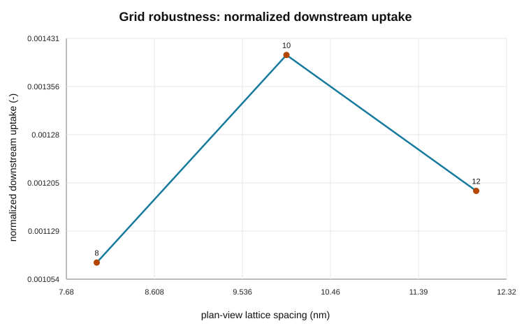
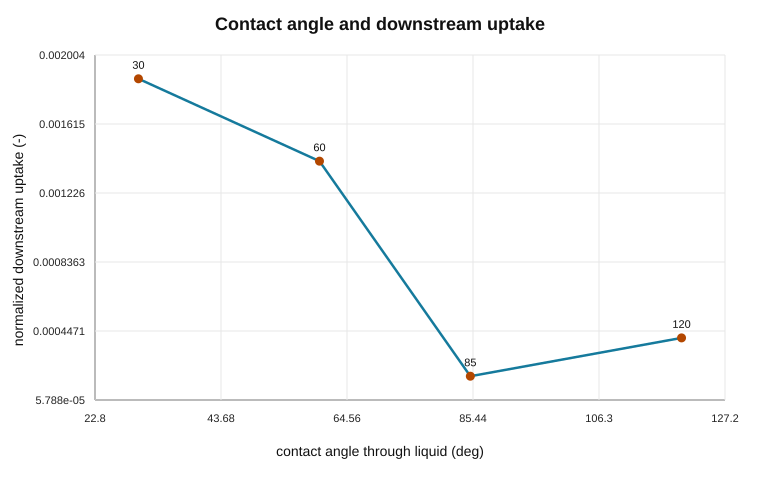
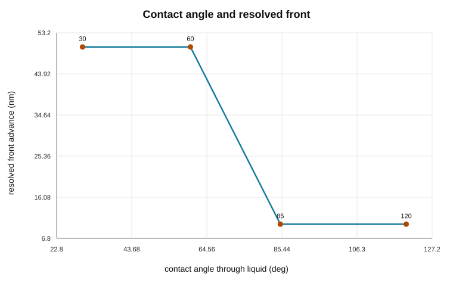
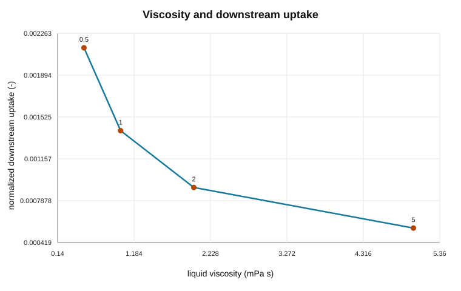
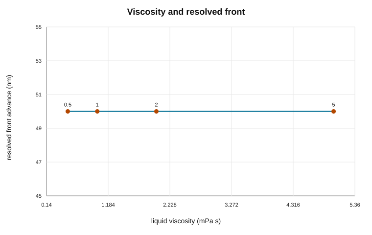
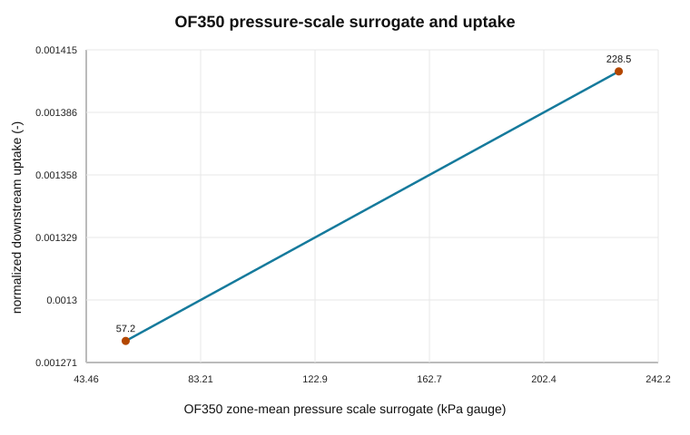
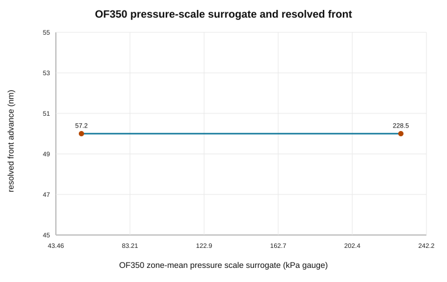

# EC1XT240 production numerical robustness and parameter study

**Status: EC1XT240_PRODUCTION_STUDY_HOLD.**  The frozen reduced baseline from merged PR #2 is unchanged; `src/minimal_ec1xt240/minimalEc1xt240.cpp` was not modified on this branch.

This package is a common-endpoint numerical study of the reduced 2-D, vented-gas OAS model. OF350 EC1XT240 zone-mean pressure minus ambient supplies only a source-backed forcing magnitude; it is not a claimed lateral pressure drop across the 2.4 um crop. Nothing here claims full 3-D, moving mesh, local perfectGas, strict OF350 regression, or experimental validation.

## Frozen common setup

- 2.4 um x 1.2 um real-OAS crop; fixed 100 um depth metadata; explicit OAS walls; no additional Darcy.
- Formal pressure-scale surrogate: 228477.1244673609 Pa gauge; 57.1659047 kPa remains the only lower source-backed comparison.
- Every actual production run uses 4,000 pressure-ramp steps plus 4,000 fixed-pressure-hold steps. `STOP_ON_RESOLVED_INTRUSION=0`; every result is evaluated at the shared 8,000-step endpoint.
- The reported numerical timestep is 5.0333333e-12 s. It is a reduced-model unit conversion, not OF350's one-second physical process time.
- At 10 nm, viscosity mapping uses `tau(mu)=0.5+0.1*(mu/1 mPa s)`, giving 0.55, 0.60, 0.70 and 1.00 for 0.5, 1, 2 and 5 mPa s. Grid cases hold physical timestep with `tau(dx)=0.5+0.1*(10 nm/dx)^2`; gas tau is separately derived to preserve its physical kinematic viscosity at the same timestep.
- `normalized downstream uptake` is uptake volume divided by the fixed 2.4 um x 1.2 um x 100 um crop volume. It is a dimensionless reduced-model comparison metric, not a resolved 3-D filling fraction.

## Numerical robustness

| dx (nm) | Nx | Ny | W (cells) | tau liquid | tau gas | front (nm) | uptake (m3) | norm uptake | uptake delta vs 10 | residual | Mach | status |
| ---: | ---: | ---: | ---: | ---: | ---: | ---: | ---: | ---: | ---: | ---: | ---: | ---: |
| 8 | 300 | 150 | 6.25 | 0.65625 | 0.523438 | 48 | 3.11046e-19 | 0.00108002 | 0.231339 | 0.00677803 | 0.00543596 | PRODUCTION_CASE_PASS |
| 10 | 240 | 120 | 5 | 0.6 | 0.515 | 50 | 4.0466e-19 | 0.00140507 | 0 | 0.00472784 | 0.00407785 | PRODUCTION_CASE_PASS |
| 12 | 200 | 100 | 4.16667 | 0.569444 | 0.510417 | 48 | 3.43372e-19 | 0.00119226 | 0.151455 | 0.00289571 | 0.00299479 | PRODUCTION_CASE_PASS |

**NUMERICAL_ROBUSTNESS_HOLD.** The 8 nm uptake differs from 10 nm by 23.13%, above the predeclared 20% screen. The physical front advance is within 4%, all three cases are stable and observable, and the 8 nm raster has a different 0.50222 fluid fraction versus 0.53333 at 10 nm. This identifies grid-dependent OAS rasterization as the leading diagnostic, not a solver crash. No post-result numerical or physical value was changed to convert HOLD into PASS.

## Contact-angle comparison

| theta (deg) | front (nm) | front (cells) | uptake (cells) | uptake (m3) | norm uptake | filling | centroid (nm) | residual | Mach | status |
| ---: | ---: | ---: | ---: | ---: | ---: | ---: | ---: | ---: | ---: | ---: |
| 30 | 50 | 5 | 53.8475 | 5.38475e-19 | 0.00186971 | 0.179229 | 1.52207 | 0.0046897 | 0.00409553 | PRODUCTION_CASE_PASS |
| 60 | 50 | 5 | 40.466 | 4.0466e-19 | 0.00140507 | 0.179129 | 1.11443 | 0.00472784 | 0.00407785 | PRODUCTION_CASE_PASS |
| 85 | 10 | 1 | 5.53221 | 5.53221e-20 | 0.000192091 | 0.179355 | 0.552885 | 0.00605249 | 0.00118887 | PRODUCTION_CASE_PASS |
| 120 | 10 | 1 | 11.7562 | 1.17562e-19 | 0.000408201 | 0.179426 | 0.745171 | 0.00650665 | 0.00112767 | PRODUCTION_CASE_PASS |

The 30-to-85 degree uptake reduction is recorded. The 120-degree point is higher than 85 degrees, so the reduced model does not support a quantitative high-angle ranking; no monotonic trend is imposed.

## Viscosity comparison

| mu (Pa s) | tau liquid | tau gas | front (nm) | uptake (m3) | norm uptake | residual | Mach | status |
| ---: | ---: | ---: | ---: | ---: | ---: | ---: | ---: | ---: |
| 0.0005 | 0.55 | 0.515 | 50 | 6.15116e-19 | 0.00213582 | 0.00547306 | 0.0053314 | PRODUCTION_CASE_PASS |
| 0.001 | 0.6 | 0.515 | 50 | 4.0466e-19 | 0.00140507 | 0.00472784 | 0.00407785 | PRODUCTION_CASE_PASS |
| 0.002 | 0.7 | 0.515 | 50 | 2.60392e-19 | 0.000904139 | 0.00437373 | 0.00299172 | PRODUCTION_CASE_PASS |
| 0.005 | 1 | 0.515 | 50 | 1.57299e-19 | 0.000546178 | 0.00419929 | 0.00159647 | PRODUCTION_CASE_PASS |

Uptake decreases over 0.5 to 5 mPa s at this shared endpoint. The quantized 50 nm resolved-front value should not be interpreted as a viscosity-independent physical front law; uptake and centroid are the more discriminating reported diagnostics.

## OF350 pressure-scale comparison

| scale | gauge Pa | front (nm) | uptake (m3) | norm uptake | mean p (Pa) | residual | Mach | status |
| ---: | ---: | ---: | ---: | ---: | ---: | ---: | ---: | ---: |
| state_57k_pa | 57165.9 | 50 | 3.69019e-19 | 0.00128132 | -3307.28 | 0.000149933 | 0.00407324 | PRODUCTION_CASE_PASS |
| final_state_228477_pa | 228477 | 50 | 4.0466e-19 | 0.00140507 | 14467.6 | 0.00472784 | 0.00407785 | PRODUCTION_CASE_PASS |

The 228 kPa source-backed scale has higher uptake than the 57 kPa scale at the common endpoint. This compares two OF350 zone-mean pressure-scale surrogates only, not measured OAS-crop pressure drops.

## Artifacts, snapshots, and next layout

Final-endpoint VTK snapshots were written externally for theta 30, 60, and 120 degrees, together with their PVD collections. Raw masks, VTK, logs, and effective commands remain outside Git; committed evidence is limited to the compact JSON, CSV tables, SVG figures, configuration, and scripts.

`scripts/run_ec1xt240_production_study.py` now supports `--layout <oas/path>` and automatically runs OAS extraction, geometry audit, and the common-endpoint case pipeline. A non-default layout requires an explicit `--crop-um`; this avoids guessing a physically comparable crop. `SIM-H.OAS` is named as the second project target, but no approved crop/formal inputs identify a ready next study. **SECOND_LAYOUT_SELECTION_REQUIRED.**

@GitHub review PR #3, starting from docs/EC1XT240_PRODUCTION_RESULTS.md, and judge whether the numerical robustness and parameter trends are sufficient to proceed directly to the second OAS layout and final report.
