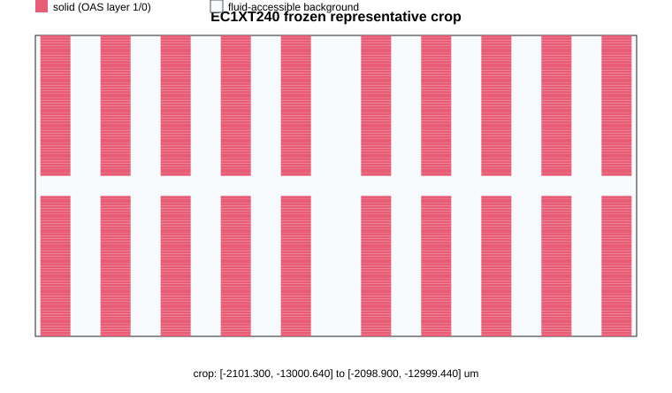
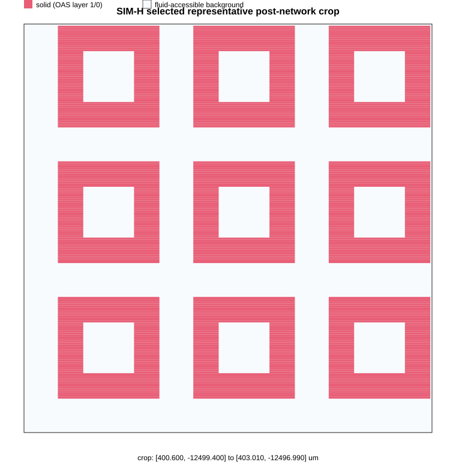
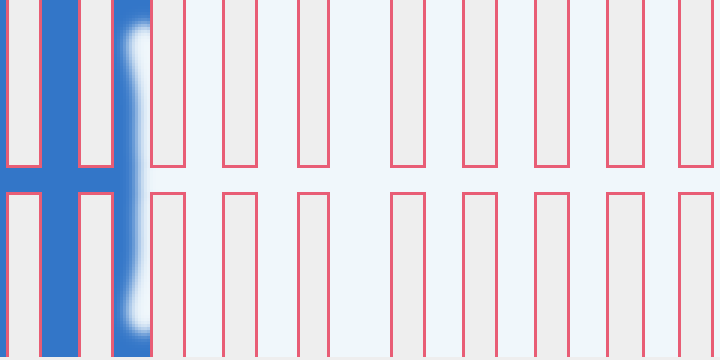
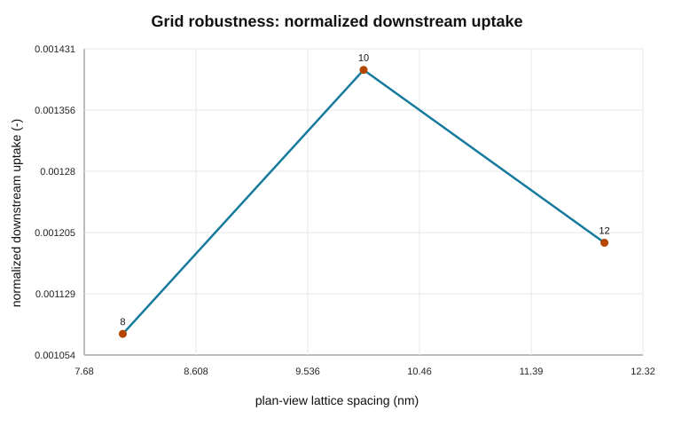
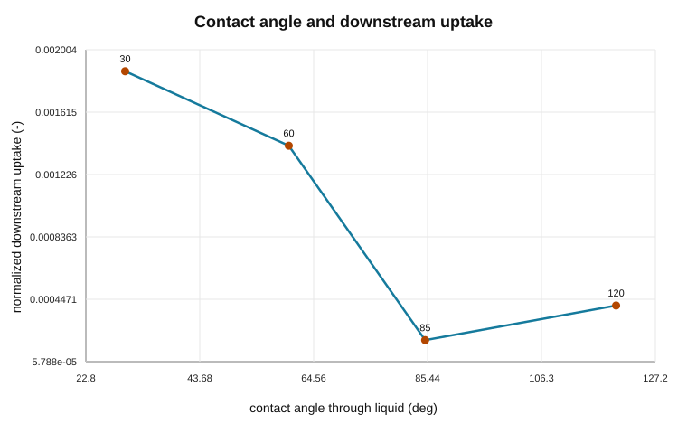
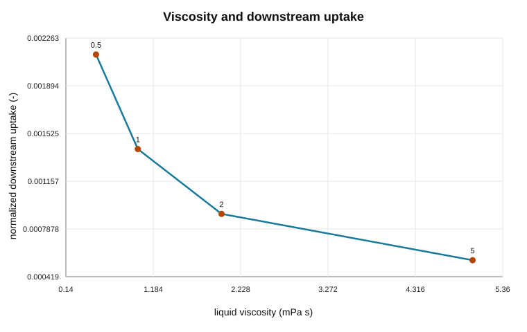
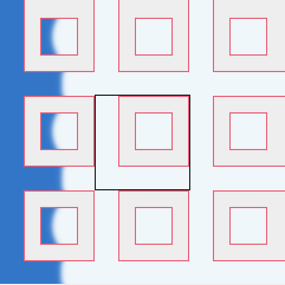
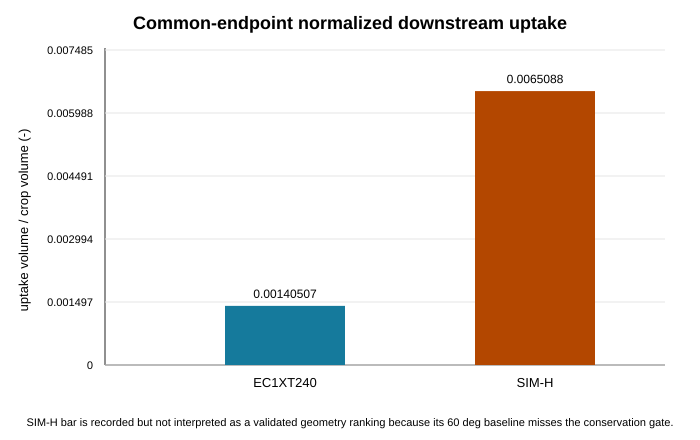

# Final simulation results: EC1XT240 and SIM-H representative crops

**Status: FINAL_LAYOUT_STUDY_HOLD.** The package preserves the frozen EC1XT240 evidence and adds a real SIM-H crop reconnaissance plus one full 8,000-step SIM-H baseline. It does not convert the SIM-H result into a geometry-performance claim because the predeclared conservation gate is not met.

## 1. Research objective

Compare two audited OAS plan-view representative geometries under a shared reduced numerical model, while retaining strict claim boundaries. This is not a full-board, 3-D, moving-template, perfect-gas, experimental, or strict OpenFOAM/OpenLB-regression study.

## 2. Geometry

EC1XT240 uses the frozen 2.4 um x 1.2 um OAS crop. SIM-H uses the independently audited 2.41 um x 2.41 um crop described in [SIM_H_GEOMETRY_SELECTION.md](SIM_H_GEOMETRY_SELECTION.md). The selected SIM-H location is a 3 x 3 solid-post/channel network; it is not represented as a literal H-shaped cavity.

## 3. Physical model

Frozen liquid inputs are rho = 1510 kg/m3, mu = 1.0e-3 Pa s, sigma = 0.0309 N/m, and liquid-measured theta = 60 degrees. The gas model is `REDUCED_VENTED_GAS`; it is explicitly not a local `perfectGas` reconstruction. Additional Darcy resistance is off because the plan-view OAS walls are explicit.

## 4. Governing equations

The reduced incompressible momentum reference is

\[
\nabla\cdot\mathbf u=0,
\qquad
\rho\left(\partial_t\mathbf u+\mathbf u\cdot\nabla\mathbf u\right)
=-\nabla p+\mu\nabla^2\mathbf u+\mathbf F.
\]

The implemented two-population path is the OpenLB conservative phase-field formulation with a Liang coupling. In notation consistent with its diffuse liquid order parameter phi,

\[
\partial_t\phi+\nabla\cdot(\phi\mathbf u)=\nabla\cdot\left[M\left(\nabla\phi-\frac{4\phi(1-\phi)}{W}\mathbf n\right)\right],
\qquad \mathbf n=\frac{\nabla\phi}{|\nabla\phi|},
\]

where W is the numerical interface width. This is a numerical conservative-phase-field statement, not a separate sharp-interface law. Capillary forcing and wall wetting are supplied by the actual Liang and `PhaseFieldCurvedWall` OpenLB operators. For a rectangular slit, \(\Delta p_c\sim2\sigma\cos\theta/b\) is retained only as a capillary-scale sanity relation.

For interpretation only, the corresponding sharp-interface capillary contribution has the form \(F_sigma=\sigma\kappa\,n\,\delta_Gamma\). It is not an additional force inserted by this project; the implemented diffuse-interface force is the Liang coupling above. The prescribed wall angle has the Young-equation interpretation \(σ_SG − σ_SL = σ cos θ\); `PhaseFieldCurvedWall` is the actual numerical wall condition, while this relation states the equilibrium contact-angle convention.

## 5. OpenLB numerical formulation

Both layouts use D2Q9 momentum and conservative phase lattices, `ConservativePhaseFieldBGKdynamics`, `LiangPostProcessor`, `PhaseFieldCurvedWall`, explicit rasterized walls, and a pressure-open inlet with a convective phase outlet. SIM-H exposed an OpenLB restriction: a convective phase outlet requires flat discrete normals. The project solver now trims only wall-adjacent endpoint voxels from the artificial multi-stripe outlet before applying that boundary. A same-condition EC1 re-run remains healthy and reproduces the frozen 50 nm front and 4.04660e-19 m3 uptake to displayed precision.

## 6. Boundary conditions

The common endpoint is 4,000 smooth pressure-ramp steps plus 4,000 fixed-pressure-hold steps, with `STOP_ON_RESOLVED_INTRUSION=0`. The source-backed forcing magnitude is 228477.1244673609 Pa gauge, namely OF350 EC1XT240 zone mean pressure minus ambient. It is not a measured lateral pressure drop of either OAS crop.

## 7. Parameter provenance

The liquid properties and surface tension are `OF350_TRANSFER_BASELINE`; theta=60 degrees is a literature assumption. The 100 um depth only converts plan-view phase inventory to volume. The reduced numerical timestep is 5.0333333e-12 s and is not OF350 physical process time.

## 8. Numerical validation

The SIM-H raster geometry passes independent connectivity and periodic-edge checks. The 60-degree runtime has no NaN, phase range [8.39862e-12, 1.00008], and Mach 0.00948992 below 0.1. Its inventory-plus-boundary-flux residual is **0.0358411**, however, which exceeds the frozen 0.01 gate. Therefore the SIM-H baseline is not released.

## 9. EC1XT240 baseline

At the common endpoint, EC1XT240 has 50 nm resolved-front advance, normalized downstream uptake 0.00140507, filling fraction 0.179129, Mach 0.00407785, and residual 0.00472784.

## 10. Grid sensitivity

The frozen EC1 8/10/12 nm screen remains `NUMERICAL_ROBUSTNESS_HOLD`: the maximum uptake deviation versus the 10 nm crop is 23.13%, despite stable and observable cases. No new SIM-H grid campaign was run; this limitation is retained rather than hidden.

## 11. Contact-angle results

Frozen EC1 contact-angle evidence is retained below. SIM-H theta=30 and theta=120 were not executed because the predeclared theta=60 health gate failed; this is a controlled non-result, not a zero-response result.

## 12. Viscosity results

Frozen EC1 viscosity evidence is retained. SIM-H 0.5 and 5 mPa s endpoints were not executed for the same baseline-health reason.

## 13. SIM-H baseline

The real SIM-H 60-degree case completed all 8,000 steps. It has 80 nm resolved x-front progression, 3.78037e-18 m3 downstream uptake, normalized downstream uptake 0.0065088, global filling 0.230162, Mach 0.00948992, and residual 0.0358411. The predeclared central 0.81 um x 0.81 um fluid-only ROI remains essentially unflooded (final filling 1.40799e-08); it is reported as a geometry-aware metric, not chosen after inspecting the outcome.

## 14. Geometry comparison

| geometry | norm. uptake | geometry-specific filling | x progress (nm) | Mach | residual | eligible |
| ---: | ---: | ---: | ---: | ---: | ---: | ---: |
| EC1XT240 | 0.00140507 | 0.179129 | 50 | 0.00407785 | 0.00472784 | true |
| SIM-H | 0.0065088 | 1.40799e-08 | 80 | 0.00948992 | 0.0358411 | false: SIM-H conservation gate HOLD |

The shared normalized downstream uptake values are tabulated, but a numeric ranking is not claimed: the inspected SIM-H crop contains nine repeated 0.6 um solid posts, with repeated constrictions, branching paths, and locally slow-access interior channels; EC1XT240 is a longitudinal-groove crop. Those differences can change capillary accessibility and pressure loss, but the SIM-H 60-degree conservation gate fails, so neither a pressure-loss inference nor a geometry-performance conclusion is released. Their geometry-specific filling metrics are deliberately different. The SIM-H bar is evidence of a completed numerical run only, not report-ready physical comparison evidence.

## 15. Limitations

- Reduced 2-D plan-view model; the 100 um groove depth is not z-resolved.
- Moving template is not explicitly meshed; upper squeeze film enters only through a source-backed pressure-scale surrogate.
- Gas is `REDUCED_VENTED_GAS`, not local `perfectGas`.
- Pressure scale is OF350 zone mean pressure minus ambient, not a measured OAS-crop pressure drop.
- Contact angle is a literature assumption.
- EC1 8/10/12 nm uptake robustness has a 23.13% maximum deviation and remains `NUMERICAL_ROBUSTNESS_HOLD`.
- No experimental validation and no strict OpenFOAM/OpenLB regression are claimed.
- SIM-H 60-degree residual is 3.584%, above the frozen 1% gate; SIM-H sensitivity and a validated geometry ranking are therefore withheld.

## 16. Conclusions

The SIM-H source was inspected, a representative connected 3 x 3 post-network crop was selected and independently audited, and its 60-degree common-endpoint run was completed. The solver generalization avoids the prior curved-normal outlet exception and preserves EC1 QoI compatibility. Nevertheless, the SIM-H boundary-flux inventory residual prevents release of the requested SIM-H sensitivity and final geometry interpretation. **Final status: FINAL_LAYOUT_STUDY_HOLD.**
