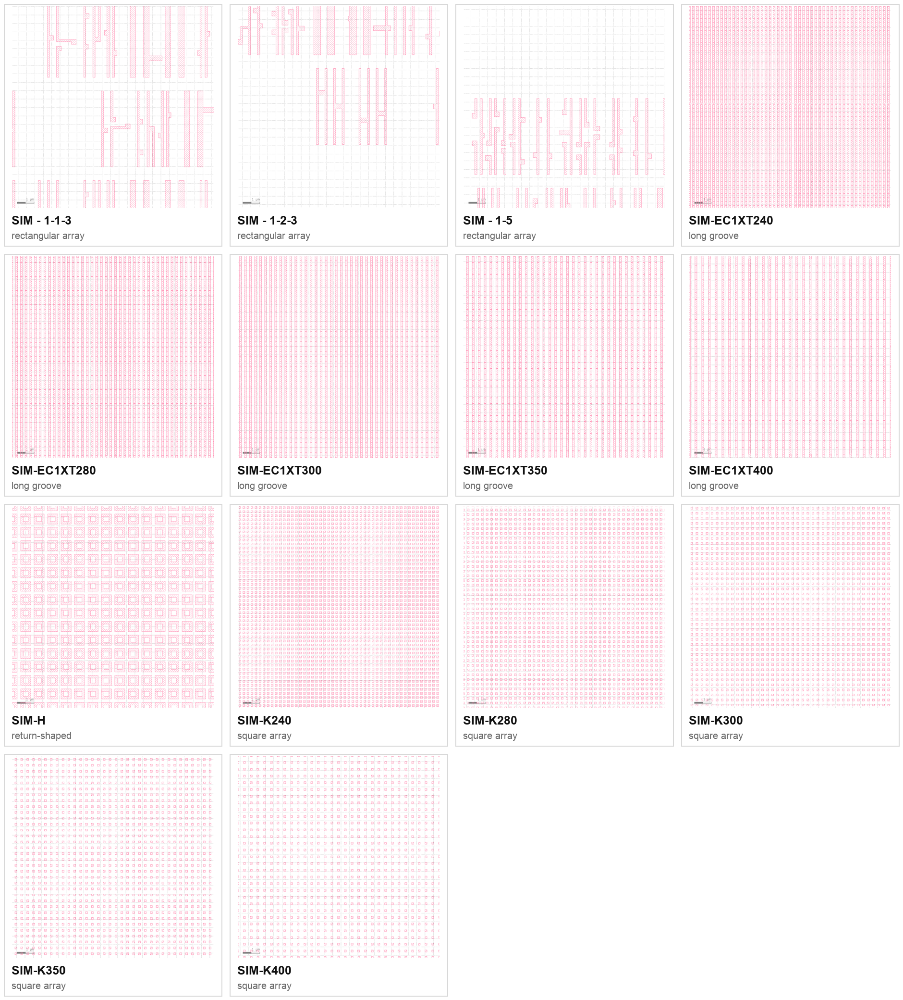
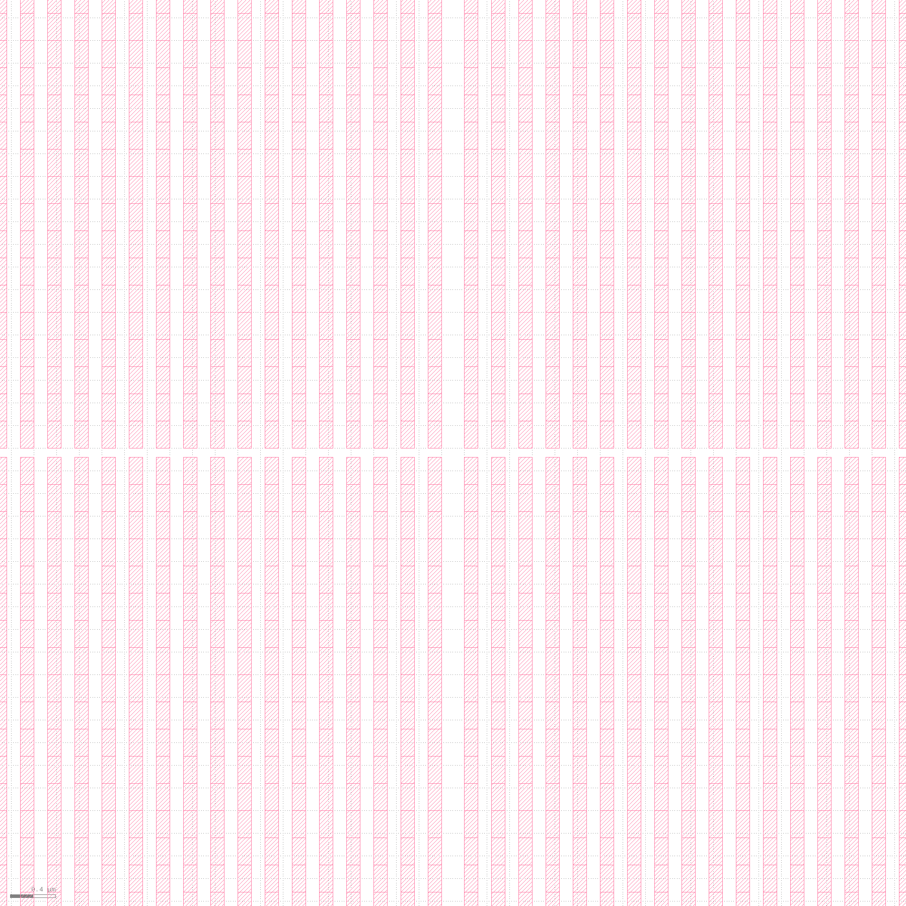

# OAS几何审计

## 颜色与相区定义

用户已确认当前KLayout显示中：

- 粉红色图形：固体墙体/阻挡结构；
- 白色背景：流体可以进入的沟槽或连通空间。

颜色只是KLayout图层显示方式。代码中必须使用“固体/流体材料编号”，不能依赖RGB颜色。

## 数据完整性

- OAS文件数：14。
- OAS输入位置：`inputs/layouts/`。
- 校验值：`inputs/layouts/SHA256SUMS`。
- `SIM-EC1XT240.OAS`：`%SEMI-OASIS`，顶层单元 `TOP`，Layer `1/0`，DBU `0.001 um`。
- EC1XT240整体平面包围盒约 `999.80 um x 999.92 um`。



## 14个版图分类

| 文件 | 初步类别 | 建模顺序 | 当前审计状态 |
|---|---|---:|---|
| `SIM-EC1XT240.OAS` | 纵向沟槽/墙阵列 | 1 | 局部尺寸已审计 |
| `SIM-EC1XT280.OAS` | 纵向沟槽/墙阵列 | 3 | 分类完成，待精审 |
| `SIM-EC1XT300.OAS` | 纵向沟槽/墙阵列 | 3 | 分类完成，待精审 |
| `SIM-EC1XT350.OAS` | 纵向沟槽/墙阵列 | 3 | 分类完成，待精审 |
| `SIM-EC1XT400.OAS` | 纵向沟槽/墙阵列 | 3 | 分类完成，待精审 |
| `SIM-H.OAS` | 回字形墙体 | 2 | 分类完成，待连通性精审 |
| `SIM-K240.OAS` | 方形固体柱阵列 | 4 | 分类完成，待精审 |
| `SIM-K280.OAS` | 方形固体柱阵列 | 4 | 分类完成，待精审 |
| `SIM-K300.OAS` | 方形固体柱阵列 | 4 | 分类完成，待精审 |
| `SIM-K350.OAS` | 方形固体柱阵列 | 4 | 分类完成，待精审 |
| `SIM-K400.OAS` | 方形固体柱阵列 | 4 | 分类完成，待精审 |
| `SIM - 1-1-3.OAS` | 复杂矩形/分支墙体 | 5 | 分类完成，待精审 |
| `SIM - 1-2-3.OAS` | 复杂矩形/分支墙体 | 5 | 分类完成，待精审 |
| `SIM - 1-5.OAS` | 复杂矩形/分支墙体 | 5 | 分类完成，待精审 |

## EC1XT240局部几何

当前从OAS图元审计得到：

- 粉红基本矩形宽约 `0.120 um`，局部长度约 `0.240 um`；
- 横向基本周期约 `0.240 um`；
- 常规白色流道宽约 `0.120 um`；
- 粉红矩形沿纵向接触并形成约 `49.92 um` 长墙段；
- 每约 `50 um` 存在约 `0.080 um` 白色横向开口；
- 部分拼接位置的白色横向间隙约 `0.200 um`，需要在三维代表单元前确认是否为设计特征；
- OAS本身只给平面几何；`100 um`深度来自用户确认，不是从OAS的z方向读取。



## 第一版几何定义

二维验证案例暂时只取规则白色狭缝：

```text
流道宽度 b = 120 nm
深度 L = 100 um
两侧 = 固体无滑移墙
上部 = 液体储液区/压力入口
沟槽初始 = 气体
底部状态 = UNKNOWN，首个数值基线建议排气
```

该二维模型用于验证，不包含OAS中的50 um纵向墙段和横向开口。真实版图性能结论必须来自后续三维代表单元。

## 仍需完成的几何工作

1. 为 `SIM-H` 输出尺寸、开口、闭合区和最小流道宽度。
2. 识别EC1XT240的最小周期三维代表单元。
3. 明确液体从版图上方、侧边还是液滴接触区进入。
4. 明确100 um结构的底部和顶部实体关系。
5. 为全部版图生成机器可读的固体掩膜与几何统计。
