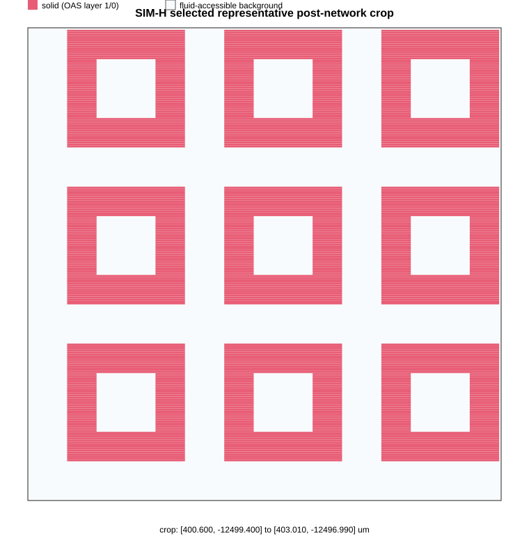

# SIM-H representative geometry selection

**Status: SIM_H_GEOMETRY_SELECTION_PASS.** The selected crop is derived from `inputs/layouts/SIM-H.OAS`; pink layer `1/0` is retained as solid and the white background as fluid-accessible space.

## Source reconnaissance

- OAS SHA-256: `38908d0462a30c68ce8701e26617a5d7d73ce25b466e44b5d79469427bc90cc3`.
- Top-cell layout bounding box: `[400.0, -12500.0, 1399.4, -11500.6]` um; only layer `1/0` is present.
- The source contains 1,537,600 repeated 0.6 um solid shapes in a 20 by 20 array of 49.4 um macro-cells. At the selected location it is a periodic solid-post network, rather than an isolated literal H-shaped cavity. The project filename is therefore retained as `SIM-H`, but the morphology is not renamed or idealized in this report.

## Candidate and selected crops

| Candidate | Crop bounding box (um) | Grid at 10 nm | Result |
| --- | --- | ---: | --- |
| A (selected) | `[400.6, -12499.4, 403.01, -12496.99]` | 241 x 241 | complete 3 x 3 post-and-channel network; x/y edge compatible |
| B (screen only) | `[400.6, -12499.4, 403.01, -12498.59]` | 241 x 81 | one-row strip; smaller but does not retain the two-dimensional network |

Selected crop dimensions are **2.41 um x 2.41 um**. It includes nine full 0.6 um solid posts with the intervening connected network, fits the 10 nm runtime, and avoids cutting the representative repeated feature at the lateral periodic seam.

## Independent 10 nm audit

- Fluid fraction: `0.581619`; solid fraction: `0.418381`.
- Fluid components: `10`; the largest has `25681` pixels and touches all four edges.
- Left-right connectivity: `True`; bottom-top connectivity: `True`.
- Periodic edge equality: x=`True`, y=`True`.
- Audit outcome: **PASS_GEOMETRY_AUDIT**.

The 100 um groove depth remains a separately declared volume-conversion metadata value. It is not resolved as a z dimension.
